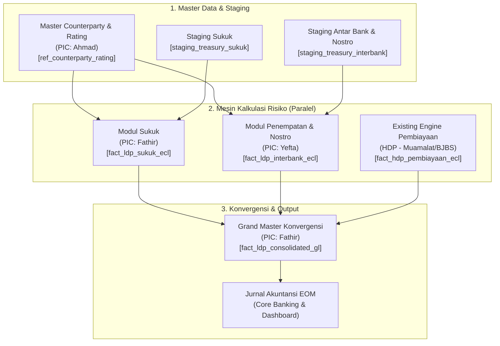

# Cetak Biru Arsitektur & Panduan Kolaborasi: Engine Treasury PSAK 413
**Subjek**: Standardisasi Pengembangan Modular Engine Treasury (LDP) Berbasis Python & Jinja SQL  
**Institusi**: Bank Aceh Syariah  
**Versi Dokumen**: 1.0  
**Tanggal**: Oktober 2026  

---

## 1. Latar Belakang & Urgensi Solusi

Dalam implementasi PSAK 413 (Instrumen Keuangan Syariah), portofolio **Treasury & Surat Berharga (Low Default Portfolio / LDP)** memiliki karakteristik kalkulasi risiko (EAD, PD, LGD) yang berbeda secara fundamental dari portofolio **Pembiayaan Ritel/Komersial (High Default Portfolio / HDP)**.

Pada tahap pengembangan Program Python, ruang lingkup pekerjaan dibagi menjadi 4 modul proses dengan penanggung jawab (PIC) berbeda:
1. **Master Counterparty** *(PIC: Ahmad)*
2. **Sukuk & Integrasi Pemeringkat Eksternal** *(PIC: Fathir)*
3. **Modul Penempatan Antar Bank & Nostro Devisa** *(PIC: Yefta)*
4. **Konvergensi Grand Master Engine (Treasury + Pembiayaan)** *(PIC: Fathir)*

### Tantangan Integrasi
Jika setiap PIC membangun proyek (repository) secara terpisah:
- **Integration Hell**: Masing-masing PIC berpotensi menggunakan versi dependensi pustaka yang tidak sinkron (`pandas`, `numpy`, `sqlalchemy`).
- **Ketergantungan Data Terputus**: Modul Yefta dan Sukuk Fathir bergantung langsung pada output Master Counterparty Ahmad. Sementara Modul Konvergensi Fathir bergantung pada output akhir kalkulasi Yefta dan Fathir.
- **Redundansi Kode**: Setiap PIC akan menulis ulang konfigurasi koneksi database, file environment (`.env`), dan utilitas logging.
- **Kesulitan Eksekusi Orkestrasi**: Sulit dipicu oleh API Java Spring Boot utama jika tersebar di 4 project terpisah.

### Solusi: *Modular Monorepo with Jinja SQL Templating*
Membangun **1 Projek Induk Bersama (*Modular Monorepo*)** dengan standar:
- Satu basis konfigurasi koneksi database dan logging.
- Folder terisolasi untuk tiap PIC di bawah direktori `modules/`.
- Standardisasi SQL ETL dinamis menggunakan engine **Jinja (Jinja2)**.
- Entrypoint pipeline terpusat (`main.py`) yang mendukung eksekusi parsial maupun menyeluruh (*end-to-end*).

---

## 2. Matriks Pembagian Tugas & Tanggung Jawab (PIC Matrix)

| No | Modul / Proses Engine | PIC | Input Utama | Output / Deliverables |
|:---|:---|:---|:---|:---|
| **a** | **Master Counterparty** | **Ahmad** | Data Kustodian, Sandi Bank BI, Database Rating Eksternal (Pefindo, Fitch, S&P). | - Tabel `ref_counterparty_rating`<br>- Tabel `ref_rating_pd_mapping`<br>- Skrip ETL Sinkronisasi Rating |
| **b** | **Sukuk & Integrasi Pemeringkat** | **Fathir** | Portofolio Sukuk, Rating Pihak Lawan, Data Makroekonomi (Z-Score PIT). | - Rating-based PD Sukuk<br>- Seniority-based LGD<br>- Tabel `fact_ldp_sukuk_ecl` |
| **c** | **Penempatan Antar Bank & Nostro Devisa** | **Yefta** | Posisi Treasury Harian (`staging_treasury_interbank`), Master Rating. | - Formula Short-Term PD Eksponensial<br>- LGD Unsecured 45%<br>- Tabel `fact_ldp_interbank_ecl` |
| **d** | **Konvergensi Grand Master Engine** | **Fathir** | Output Fact LDP (Yefta + Fathir) & Fact HDP (Pembiayaan existing). | - Amalgamasi Nilai Rupiah CKPN<br>- Tabel `fact_ldp_consolidated_gl`<br>- Jurnal Akuntansi End of Month (EOM) |

---

## 3. Diagram Alur Ketergantungan Data (Data Dependency)



---

## 4. Struktur Direktori Projek Induk (*Project Tree*)

Berikut adalah blueprint susunan folder projek induk `treasury-engine-psak413`:

```text
treasury-engine-psak413/
│
├── config/                         # Konfigurasi Global & Environment
│   ├── __init__.py
│   ├── database.py                 # Singleton Engine SQLAlchemy & Session Factory
│   └── settings.py                 # Loader variabel .env
│
├── common/                         # Shared Utilities
│   ├── __init__.py
│   ├── logger.py                   # Logger terstandarisasi (Rotating File + Console)
│   ├── template_engine.py         # Renderer template SQL Jinja2
│   └── math_utils.py               # Fungsi rumus matematika umum
│
├── sql/                            # Template SQL Murni (Jinja2)
│   ├── 01_master_counterparty.sql  # [Ahmad]
│   ├── 02_sukuk.sql                # [Fathir]
│   ├── 03_interbank_nostro.sql     # [Yefta] Query ETL Staging ke Fact
│   └── 04_konvergensi.sql          # [Fathir] Query Amalgamasi ke GL
│
├── modules/                        # Logika Pemrosesan Tiap PIC
│   ├── __init__.py
│   ├── master_counterparty/        # [PIC: Ahmad]
│   │   ├── __init__.py
│   │   └── counterparty_sync.py
│   │
│   ├── sukuk/                      # [PIC: Fathir]
│   │   ├── __init__.py
│   │   └── sukuk_engine.py
│   │
│   ├── interbank_nostro/           # [PIC: Yefta]
│   │   ├── __init__.py
│   │   └── interbank_engine.py     # Perhitungan Short-Term PD & Final CKPN
│   │
│   └── konvergensi/                # [PIC: Fathir]
│       ├── __init__.py
│       └── grand_master_engine.py  # Rekonsiliasi EOM & Export Jurnal
│
├── tests/                          # Automated Testing & Mock Fixtures
│   ├── __init__.py
│   ├── fixtures/                   # Mock Data CSV/JSON untuk Testing Mandiri
│   │   ├── mock_counterparty.json
│   │   └── mock_interbank_staging.json
│   ├── test_counterparty.py
│   ├── test_sukuk.py
│   ├── test_interbank.py           # Unit test kalkulasi Yefta
│   └── test_konvergensi.py
│
├── main.py                         # Master CLI Orchestrator
├── requirements.txt                # Dependensi Python Tim
├── .env.example                    # Format konfigurasi database
└── README.md                       # Panduan Onboarding Developer
```

---

## 5. Standar Penerapan SQL Templating (Jinja2)

Penggunaan Jinja memisahkan kode query SQL yang panjang dari kode logika Python. Query SQL dapat langsung diuji di database tool (DBeaver/DataGrip) dan dirender dinamis di Python.

### A. Template Engine Helper (`common/template_engine.py`)
```python
from jinja2 import Environment, FileSystemLoader
from pathlib import Path

# Lokasi direktori folder sql/
SQL_DIR = Path(__file__).resolve().parent.parent / "sql"
jinja_env = Environment(loader=FileSystemLoader(str(SQL_DIR)))

def render_sql(template_name: str, **params) -> str:
    """
    Me-render query SQL dari file template Jinja2.
    Contoh: render_sql("03_interbank_nostro.sql", tgl_cut_off='2026-10-31')
    """
    template = jinja_env.get_template(template_name)
    return template.render(**params)
```

### B. Template SQL Modul Interbank & Nostro (`sql/03_interbank_nostro.sql`)
```sql
-- ETL Fase 2: Ekstraksi EAD, Initial Rating PD, dan LGD Unsecured
BEGIN;

TRUNCATE TABLE fact_ldp_interbank_ecl;

INSERT INTO fact_ldp_interbank_ecl (
    id_penempatan, 
    stage_psak, 
    ead_treasury, 
    annual_pd_rate, 
    short_term_pd, 
    lgd_unsecured, 
    nominal_ckpn
)
SELECT 
    s.id_penempatan,
    -- Penentuan Stage: Sovereign = Stage 1, Non-Investment = Stage 2
    CASE 
        WHEN cr.kategori_institusi = 'SOVEREIGN' THEN 1
        WHEN rm.kategori_grade = 'NON_INVESTMENT_GRADE' THEN 2 
        ELSE 1
    END AS stage_psak,
    
    -- Kalkulasi EAD (Pokok + Akrual)
    (s.nominal_pokok + s.akrual_imbalan) AS ead_treasury,
    
    -- Mapping Annual PD berdasarkan rating
    CASE 
        WHEN cr.kategori_institusi = 'SOVEREIGN' THEN 0.0001
        ELSE COALESCE(rm.ttc_pd_rate, 0.0500) 
    END AS annual_pd_rate,
    
    0.0000 AS short_term_pd,
    0.4500 AS lgd_unsecured, -- Basel Standard Unsecured Interbank
    0.00 AS nominal_ckpn

FROM staging_treasury_interbank s
LEFT JOIN ref_counterparty_rating cr ON s.kode_counterparty = cr.kode_counterparty
LEFT JOIN ref_rating_pd_mapping rm ON cr.rating_saat_ini = rm.kode_rating
WHERE s.tgl_cut_off = '{{ tgl_cut_off }}';

COMMIT;
```

### C. Eksekusi Python Modul Interbank (`modules/interbank_nostro/interbank_engine.py`)
```python
import numpy as np
import pandas as pd
from common.db import get_engine
from common.template_engine import render_sql
from common.logger import get_logger

logger = get_logger("InterbankEngine")

def calculate_interbank_ecl(tgl_cut_off: str):
    engine = get_engine()
    logger.info(f"Memulai ETL Interbank untuk cut-off: {tgl_cut_off}")

    # 1. Jalankan SQL ETL berbasis template Jinja
    etl_sql = render_sql("03_interbank_nostro.sql", tgl_cut_off=tgl_cut_off)
    with engine.begin() as conn:
        conn.execute(etl_sql)

    # 2. Tarik data staging & fact untuk perhitungan Short-Term PD
    query = """
        SELECT f.id_penempatan, f.ead_treasury, f.annual_pd_rate, f.lgd_unsecured, s.sisa_hari_jatuh_tempo
        FROM fact_ldp_interbank_ecl f
        INNER JOIN staging_treasury_interbank s ON f.id_penempatan = s.id_penempatan
    """
    df = pd.read_sql(query, engine)

    # 3. Kalkulasi Matematis Eksponensial (Vectorized via NumPy)
    # Rumus: Short_Term_PD = 1 - (1 - Annual_PD) ^ (Days / 365)
    days = np.where(df['sisa_hari_jatuh_tempo'] > 0, df['sisa_hari_jatuh_tempo'], 1.0)
    annual_pd = df['annual_pd_rate'].astype(float)
    short_term_pd = 1.0 - np.power((1.0 - annual_pd), (days / 365.0))
    
    # Kalkulasi CKPN = EAD * Short_Term_PD * LGD
    nominal_ckpn = df['ead_treasury'].astype(float) * short_term_pd * df['lgd_unsecured'].astype(float)

    df['short_term_pd'] = short_term_pd.round(12)
    df['nominal_ckpn'] = nominal_ckpn.round(2)

    # 4. Simpan kembali hasil perhitungan ke database
    # (Update batching fact_ldp_interbank_ecl)
    logger.info("Kalkulasi matematis selesai. Memperbarui tabel fact.")
    return df
```

---

## 6. Pipeline Orchestrator Terpusat (`main.py`)

File `main.py` di-desain sebagai gerbang eksekusi tunggal via antarmuka baris perintah (*CLI*):

```python
import argparse
from common.logger import get_logger
from modules.master_counterparty.counterparty_sync import run_counterparty_sync
from modules.sukuk.sukuk_engine import run_sukuk_engine
from modules.interbank_nostro.interbank_engine import calculate_interbank_ecl
from modules.konvergensi.grand_master_engine import run_convergence_engine

logger = get_logger("MainPipeline")

def main():
    parser = argparse.ArgumentParser(description="Treasury PSAK 413 Engine Pipeline")
    parser.add_argument(
        "--module", 
        choices=["all", "counterparty", "sukuk", "interbank", "konvergensi"], 
        default="all",
        help="Pilih modul spesifik atau 'all' untuk seluruh proses."
    )
    parser.add_argument("--cut-off", required=True, help="Tanggal Cut Off (format: YYYY-MM-DD)")
    args = parser.parse_args()

    cut_off = args.cut_off
    logger.info(f"Menjalankan pipeline dengan target modul: [{args.module}] untuk cut-off: {cut_off}")

    try:
        if args.module in ["counterparty", "all"]:
            run_counterparty_sync(cut_off)
        if args.module in ["sukuk", "all"]:
            run_sukuk_engine(cut_off)
        if args.module in ["interbank", "all"]:
            calculate_interbank_ecl(cut_off)
        if args.module in ["konvergensi", "all"]:
            run_convergence_engine(cut_off)
            
        logger.info("Eksekusi pipeline berhasil diselesaikan.")
    except Exception as e:
        logger.error(f"Kegagalan pipeline: {str(e)}", exc_info=True)
        exit(1)

if __name__ == "__main__":
    main()
```

### Cara Eksekusi:
```bash
# Uji coba modul sendiri oleh Yefta:
python main.py --module interbank --cut-off 2026-10-31

# Uji coba modul Sukuk oleh Fathir:
python main.py --module sukuk --cut-off 2026-10-31

# Eksekusi End-to-End seluruh proses (dipanggil oleh Spring Boot):
python main.py --module all --cut-off 2026-10-31
```

---

## 7. Aturan Kolaborasi Git & Unblocking Strategy

Untuk mencegah konflik saat pengerjaan serentak:

### A. Strategi Percabangan Git (Git Branching)
1. **Branch `main`**: Kode produksi yang stabil dan siap dideploy ke server.
2. **Branch `develop`**: Tempat peleburan kode antar PIC.
3. **Branch Fitur Masing-Masing**:
   - `feature/counterparty-ahmad`
   - `feature/sukuk-fathir`
   - `feature/interbank-yefta` (Branch Anda)
   - `feature/konvergensi-fathir`

### B. Strategi Mocking (Bekerja Tanpa Saling Menunggu)
Agar Anda (Yefta) tidak perlu menunggu modul Ahmad selesai 100%:
1. Buat data tiruan (*fixture mock*) pada tabel `ref_counterparty_rating` dan `staging_treasury_interbank` di database development lokal Anda.
2. Selesaikan formula Python dan template SQL Jinja Anda.
3. Saat modul Ahmad selesai, Anda cukup melakukan integrasi tanpa merubah struktur kalkulasi logika Anda.

---

## 8. Ringkasan Kesimpulan
Membangun satu **Projek Induk Modular Monorepo** adalah keputusan teknis paling efisien untuk proyek Treasury PSAK 413 ini. Pendekatan ini menjamin integrasi yang mulus, kode yang rapi dan terstandarisasi dengan Jinja SQL, serta mempermudah orkestrasi pemanggilan batch dari dashboard Java Spring Boot.
